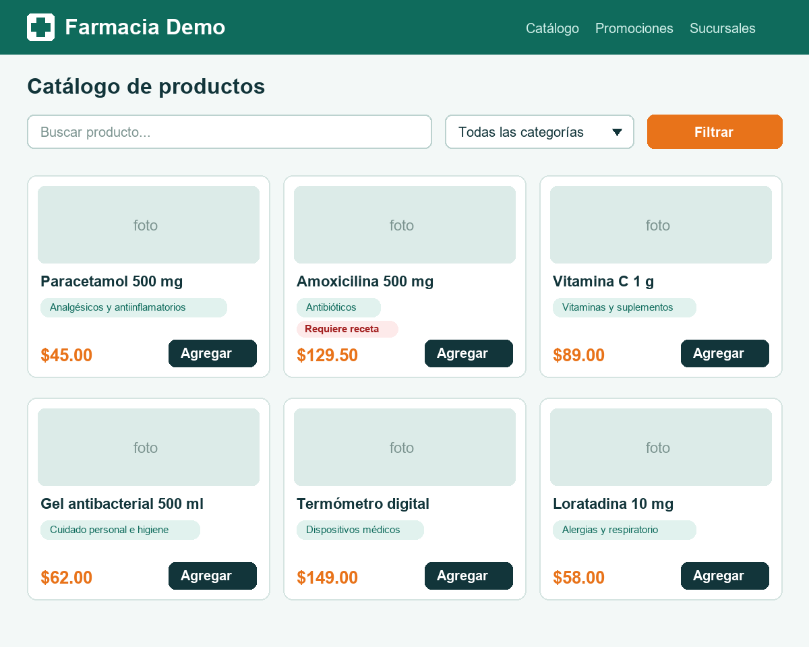

# Ejercicio 5: Del mockup a una página Razor

**Módulo:** [9. Imagen a código](../modulos/09-imagen-a-codigo.md) · **Tiempo:** 30 min
**Archivos:** `ejercicios/ej5-imagen-a-codigo/mockup-catalogo.png` y `src/Farmacia.Api/Pages/`

## Escenario

Diseño entregó el mockup del catálogo de **Farmacia Demo**. Tu trabajo es convertirlo en una **página Razor** de ASP.NET Core que muestre los productos de la farmacia.



## Requisitos funcionales

- Página `Pages/Catalogo.cshtml` con su `PageModel` (`Catalogo.cshtml.cs`), en la ruta `/catalogo` (`@page "/catalogo"`).
- El `PageModel` recibe `RepositorioProductos` por inyección de dependencias y lista los productos en el servidor.
- Los productos con `RequiereReceta` muestran una etiqueta **"Requiere receta"** como en el mockup.
- El filtro de categoría usa el parámetro `?categoria=` y la búsqueda por nombre usa `?q=`; ambos con un formulario `GET`.
- Sin resultados, la página muestra un mensaje de estado vacío.
- Solo HTML, CSS propio y Razor. **Sin librerías de componentes ni de estilos.**

Para verla en el navegador:

```bash
dotnet run --project src/Farmacia.Api --urls http://localhost:5000
```

y abre `http://localhost:5000/catalogo`.

## Parte 1: primera versión (10 min)

1. Selecciona un modelo con **visión**.
2. Adjunta `mockup-catalogo.png` al chat.
3. En modo Agent, escribe un prompt con **contexto, intención y restricciones** (módulo 5). Debe pedir crear `Pages/Catalogo.cshtml` y `Pages/Catalogo.cshtml.cs`.
4. Revisa los diffs y abre la página en el navegador.

## Parte 2: compara e itera (15 min)

Abre el mockup junto a tu página y **anota 3 diferencias visuales concretas** (por ejemplo: color del botón, espaciado, tamaño de la etiqueta).

Itera **dos veces** con mensajes de seguimiento precisos:

1. Una corrección visual ("las tarjetas deben tener 3 columnas en escritorio").
2. Una mejora de comportamiento que **no se ve en el mockup**:
    - estado vacío cuando no hay resultados,
    - o diseño responsivo para celular,
    - o que el filtro conserve lo que escribió la persona.

## Parte 3: revisión (5 min)

Revisa el código generado:

- [ ] ¿Imprime los datos con `@producto.Nombre` (Razor los codifica) o usa `@Html.Raw(...)`? (riesgo XSS).
- [ ] ¿La lógica de filtrado está en el `PageModel` o se coló en la vista?
- [ ] ¿El buscador y el selector tienen etiqueta accesible (`aria-label` o `<label>`)?
- [ ] ¿Usa `decimal` para formatear el precio y una cultura fija, o depende de la configuración regional del servidor?

Si te sobra tiempo, pide a Copilot una prueba con `WebApplicationFactory` que pida `/catalogo?categoria=...` y compruebe el HTML.

## Criterios de aceptación

- [ ] `/catalogo` muestra los 6 productos con nombre, categoría y precio.
- [ ] Solo el producto que requiere receta lleva la etiqueta.
- [ ] El filtro y la búsqueda funcionan.
- [ ] Anotaste 3 diferencias contra el mockup y corregiste al menos 2.
- [ ] Hay estado vacío o diseño responsivo.
- [ ] Identificaste al menos 1 problema de calidad en el código generado.
- [ ] `dotnet test tests/Farmacia.Api.Tests` sigue en verde.
